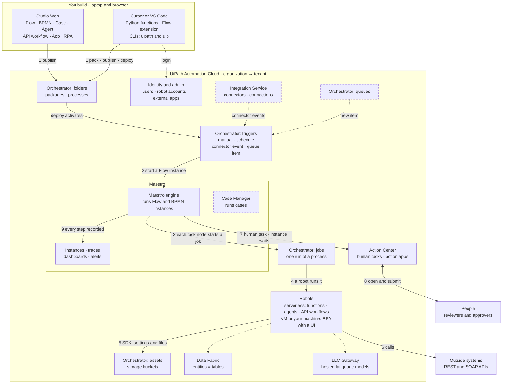
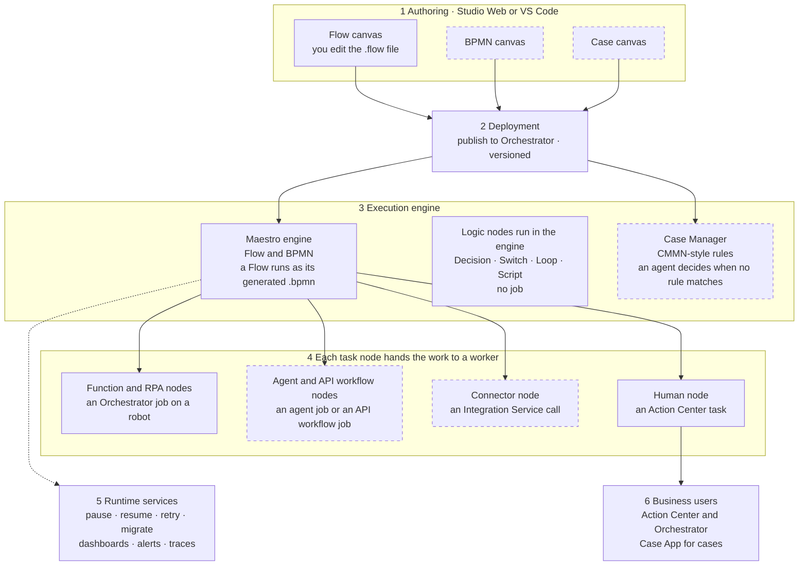
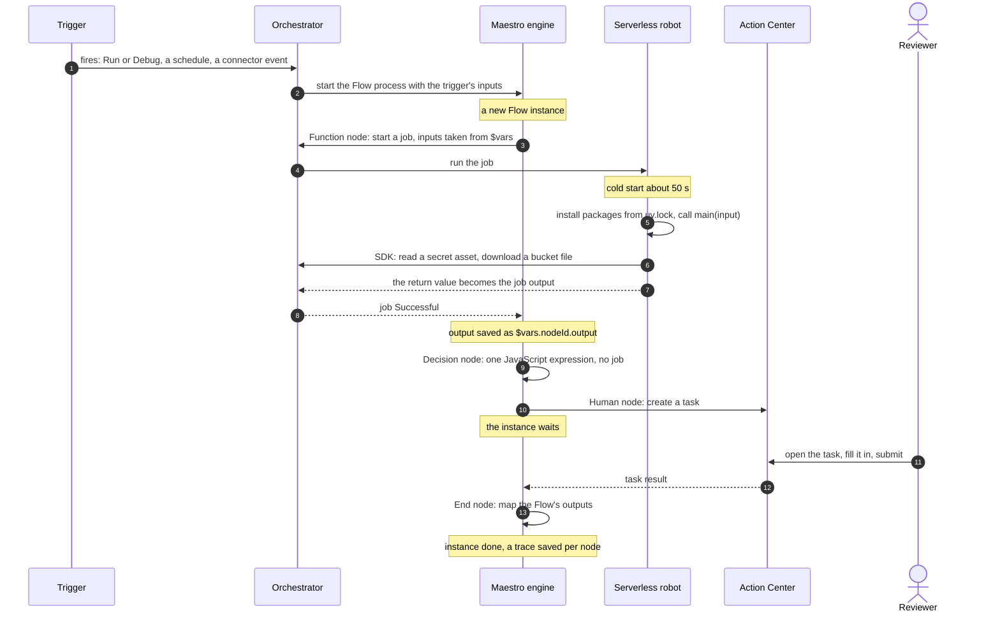
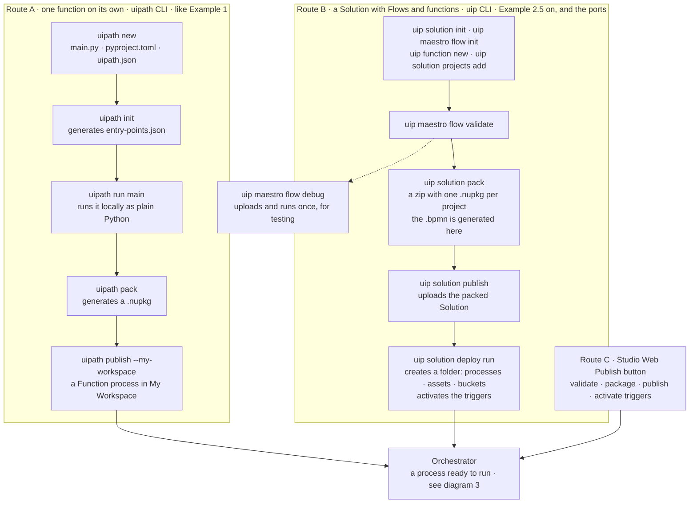

# UiPath platform: architecture diagrams

Four diagrams of how the UiPath platform fits together. They go from the whole platform down to one
run, then show how your code gets there. Each diagram has numbered steps, and the table under it
explains every number.

- **Open in Cursor:** install the Mermaid preview extension once (command below). Then open this file
  and press `Cmd+Shift+V`. Jump between diagrams with the links below or Cursor's Outline view.

  ```bash
  /Applications/Cursor.app/Contents/Resources/app/bin/cursor --install-extension bierner.markdown-mermaid
  ```

  The plain `cursor` on your PATH is the Cursor Agent CLI, which can't install extensions, so use
  the full path. Or install it in Cursor: `Cmd+Shift+X`, then search for "Markdown Preview Mermaid
  Support".

- **Elsewhere:** Obsidian and GitHub render the diagrams with no extension.
- **Legend:** a solid box is used by the UiPath-WorkFusion ports today. A dashed box is available
  the platform but not used by the ports yet. Numbered arrows are the main path; dotted arrows are
  side connections.

**Contents**

1. [The big picture](#1-the-big-picture): every component and how they connect
2. [Inside Maestro](#2-inside-maestro): its layers, and who does each task
3. [One Flow run, step by step](#3-one-flow-run-step-by-step)
4. [From your laptop to a running process](#4-from-your-laptop-to-a-running-process)
5. [In WorkFusion terms](#5-in-workfusion-terms)

## 1. The big picture

Everything lives in an **organization** (`cloud.uipath.com/<org>`), which holds one or more
**tenants**. "All tenants contain an Orchestrator service"
([About tenants](https://docs.uipath.com/automation-cloud/automation-cloud/latest/admin-guide/about-tenants)).
Your practice tenant is `DefaultTenant`, the one every new organization gets.

Orchestrator is the control plane, but its parts come into play at different moments. So each part
is its own box, named `Orchestrator: …`.



| # | What happens | Components |
|---|---|---|
| 1 | You publish your work, with Studio Web's **Publish** button or `uip solution pack → publish → deploy run` ([diagram 4](#4-from-your-laptop-to-a-running-process)) | Studio Web, CLIs → Orchestrator |
| 2 | A trigger starts the Flow: Run or Debug, a schedule, a connector event, or a queue item ("1 Queue Item = 1 Maestro process instance") | Orchestrator → Maestro |
| 3 | The engine walks the graph. Each task node becomes an Orchestrator job | Maestro → Orchestrator |
| 4 | A robot runs the job. Functions run on serverless robots | Robots |
| 5 | Your code reads settings and files through the `uipath` SDK | Assets, storage buckets |
| 6 | Your code calls outside systems itself (the ports use plain HTTP). Integration Service connectors could do it too; none are used here | Outside systems |
| 7 | A human node creates an Action Center task, and the instance waits | Action Center |
| 8 | A person opens the task and submits it | People |
| 9 | Every node's input, output and duration is recorded | Maestro instances and traces |

- **Folders** organise and secure everything in Orchestrator. Your **My Workspace** is a personal
  folder; a Solution deploy creates a shared one.
- **Orchestrator also has API triggers** (start a job with an HTTP call). The docs don't say whether
  one can start a Flow, so the diagram leaves it out. Example 10 is meant to test it.
- **Login:** `uipath auth` and `uip login` both authenticate against the identity service. The
  pipelines use an external app, `WorkfusionAzurePipelines`.

## 2. Inside Maestro

UiPath's own model has a five-layer stack: "Maestro BPMN, Maestro Case, and Maestro Flow are three
ways to build on the same orchestration platform, not three separate products"
([Maestro architecture](https://docs.uipath.com/maestro/automation-cloud/latest/user-guide/maestro-architecture)).
This diagram adds layer 4, the hand-off to workers, to show who does each task.



| # | Layer | What it does | In the ports |
|---|---|---|---|
| 1 | Authoring | Where you draw the process. Flow also builds in VS Code and Cursor | Flow only |
| 2 | Deployment | "All three publish to Orchestrator and are versioned the same way" | Solutions deployed by Azure DevOps |
| 3 | Execution engine | Runs instances and decides the next step. Logic nodes run here and start no job. The Case Manager runs cases. The canvases combine: "a case can invoke a BPMN process as a task, and a Flow can call a BPMN subprocess" | Maestro engine |
| 4 | Task nodes | Each one starts work elsewhere: a job, a connector call or a human task | Function, RPA and human nodes |
| 5 | Runtime services | Instance management, dashboards, alerts, process optimization | Instance view and traces |
| 6 | Business users | Where people take part in running work | Isaac's `ActionTaskApp` in Action Center |

- **What runs the engine:** on Automation Suite (self-hosted), "Temporal as a Service (TaaS) is the
  durable workflow engine that powers Maestro"
  ([page](https://docs.uipath.com/maestro/automation-suite/2.2510/user-guide/temporal-as-a-service)).
  For Automation Cloud, which you use, it isn't documented. **Inference:** the same.
- **Why there's no message queue between steps:** a durable engine saves each instance's progress
  as it goes, so waiting for a job or a person is a saved state, not a message in a queue.
- **Task types** (the `serviceType` of a task node in the `.flow` file):

  | `serviceType` | Node |
  |---|---|
  | `Orchestrator.ExecuteFunctionAsync` | Function, `uipath.core.function.<key>` |
  | `Orchestrator.StartJob` | RPA process |
  | `Orchestrator.StartAgentJob` | Agent |
  | `Orchestrator.ExecuteApiWorkflowAsync` | API workflow |
  | `Orchestrator.StartFlowProcess` | Call another Flow, `uipath.core.flow.<key>` |
  | `Intsvc.ActivityExecution` | Connector |
  | `Actions.HITL` | Human task |

  The UiPath plugin's BPMN spec was extracted earlier and
  lacks `ExecuteFunctionAsync` and `StartFlowProcess`, so it is not the full list. Counted in
  the ports' `.flow` files: `ExecuteFunctionAsync` 29, `StartFlowProcess` 19,
  `ExecuteApiWorkflowAsync` 7, `StartAgentJob` 3, `StartJob` 3. Flow node types:

**Which nodes start a job.** Not every node is a job. Only the nodes that hand work to Orchestrator
are, so counting jobs is how you size a Flow.

| Node | Runs on | Starts a job? |
|---|---|---|
| Function | Orchestrator job, serverless | **Yes** (`ExecuteFunctionAsync`) |
| Agent | Orchestrator job, serverless | **Yes** (`StartAgentJob`) |
| API workflow | Orchestrator job, serverless | **Yes** (`ExecuteApiWorkflowAsync`) |
| RPA process | Orchestrator job on the folder's robot (serverless, VM or on-prem: unknown which) | **Yes** (`StartJob`) |
| Call another Flow | A new child Flow instance, plus a job record | **Yes, a different kind** (`StartFlowProcess`) |
| Script | Maestro engine | No |
| Decision, Switch | Engine gateways | No |
| Loop, Merge | Engine. The nodes in the loop body start their own jobs | No |
| Subflow (`core.subflow`) | Engine, same instance as the parent | No |
| Triggers, End | Engine | No |
| Connector, HTTP | Integration Service | No |
| Human | Action Center | No |
| Delay | Engine timer | No (**Inference**: no repo Flow uses one) |

- **No UiPath page says "logic nodes start no job".** It is **Inference** from how they are
  generated (Script is a `bpmn:ScriptTask`, `EntityDataEnrichment.flow:2232`) and from measured job
  counts: on Isaac's 1M run each loop iteration was "three serverless jobs (split, emit, merge)",
  82 empty iterations took 8–9 minutes.
- **The ~50 s cold start is a job cost.** Script and Decision nodes pay none (**Inference**).
- **Call another Flow is not a plain job.** It makes a child instance and a job record that can
  fail separately. In D31 a child instance faulted while its job stayed Running, and in other runs
  no child job existed. The parent waited 3 h because the node has no timeout
  (row D31; it was reverted and is
  open again).
- **Unknown:** which robot runs a child Flow's job; whether a faulted or cancelled Function job is
  billed (serverless bills per runtime minute, so **Inference**: yes); whether a child instance
  bills separately.

**Maestro Orchestrate vs Maestro Automate.** Studio Web's **Create New** menu lists both. They are
"two separate products" on the same engine
([Choosing between them](https://docs.uipath.com/maestro/automation-cloud/latest/user-guide/choosing-maestro-orchestrate-or-maestro-automate)):

| | Maestro Orchestrate | Maestro Automate |
|---|---|---|
| Canvases | Case, Flow and BPMN | Flow only |
| Longest single run | No cap | 24 hours |
| Runs at the same time | No cap | 50 |
| Live instance control | Retry, cancel, pause, resume, migrate, go-to | Retry and cancel |
| Dashboards, incidents, alerts | Yes | No |

## 3. One Flow run, step by step

The example Flow has a trigger, a Function node, a Decision, a human task and an End. The numbers
on the arrows match the table.



| # | What happens | Where you can see it |
|---|---|---|
| 1 | A trigger fires. A Flow has Manual, Scheduled and connector-based triggers ([Triggers](https://docs.uipath.com/maestro/automation-cloud/latest/user-guide/triggers)) | Studio Web **Debugor Orchestrator → Triggers |
| 2 | Orchestrator starts the Flow process, and the engine creates an instance. Trigger inputs are read as `$vars.<trigger>.output.<input>` | Maestro → Flow instances |
| 3 | A Function node asks Orchestrator for a job. Its inputs are bound from Flow variables | Orchestrator → Jobs |
| 4 | Orchestrator gives the job to a serverless robot. A cold start takes about 50 s | Orchestrator → Jobs |
| 5 | The job installs dependencies from `uv.lock`, injects the folder and robot keys, and calls `main(input)` ([coded-functions.md](coded-functions.md#lifecycle)) | Job logs |
| 6 | `UiPath` in your code reads assets and buckets with the job's injected credentials | Job logs |
| 7 | The return value is stored as the job output | Job details |
| 8 | The engine sees the job finish, and the output becomes a Flow variable | Execution trace: node output |
| 9 | A Decision runs inside the engine; no job starts | The trace highlights the branch taken |
| 10 | A human node creates a task. "The Flow parks until the task is submitted" ([equivalent.md](equivalent.md)) | The instance shows as waiting |
| 11 | A person opens the task and submits it, from Action Center, email, Slack or Teams | Action Center inbox |
| 12 | The task result comes back and the instance resumes | Execution trace |
| 13 | The End node maps the outputs and the run finishes | Execution history: status, trigger, duration, version ([Observing runs](https://docs.uipath.com/maestro/automation-cloud/latest/user-guide/observing-runs)) |

**When one Flow calls another**, there are two patterns:

| Pattern | Use it | How |
|---|---|---|
| Wait on a child Flow | Within one Solution, like Example 3.1 | A node that calls the other Flow with `fireAndForget: false`; the parent waits |
| Start and poll | Across Solutions, like Isaac calling Evan, OWS and OrgClas | A function runs `processes.invoke` (gets a job key), then `jobs.retrieve` every 5 s, then `jobs.extract_output` |

Isaac uses start-and-poll across Solutions because a waiting cross-Solution node "has no timeout
and hung for 3 h when the child faulted" ([equivalent.md](equivalent.md)).

**How many jobs run at once.** The limit sits on the tenant, not on the Flow:

| Account | Concurrent serverless jobs per tenant |
|---|---|
| Enterprise | 50 |
| Community | 3 |
| Other plans | Unknown: the page names only these two |

- **Source:** the [serverless robots FAQ](https://docs.uipath.com/orchestrator/automation-cloud/latest/user-guide/frequently-asked-questions-cloud-robots-serverless)
  says "up to fifty jobs concurrently per tenant" (Enterprise). It says "jobs", not "Function jobs".
  **Inference:** the cap covers Function jobs, since serverless robots run Agent, Function and API
  jobs.
- **Shared:** every Flow, run and Solution in the tenant competes for the same 50. Maestro Automate's
  50 concurrent *runs* (section 2) is a different limit: it counts Flow instances, this counts jobs.
- **Robot Units (RUs) also limit you.** A job burns RUs for each minute it runs. In production a
  Small robot uses 1 RU a minute, Standard 2, Medium 4 and Large 10; testing is half
  ([Consuming Robot Units](https://docs.uipath.com/robot/automation-cloud/latest/user-guide/consuming-robot-units)).
  The OrgClas deploy sets a Medium robot, so 4 RUs a minute. When RUs run out, "new serverless jobs
  cannot start until additional RUs become available".
- **Past the cap: undocumented.** Neither page says whether extra jobs wait or fault.
  **Inference:** they sit in Pending. Test on the practice tenant before relying on it.
- **Maestro adds no cap of its own.** The Loop node's Parallel option has no max-iterations or
  concurrency setting ([Loop node](https://docs.uipath.com/maestro/automation-cloud/latest/user-guide/node-loop)).
  Maestro slows one instance that runs many activities in a short time, with no published threshold
  ([Instance throttling](https://docs.uipath.com/maestro/automation-cloud/latest/user-guide/instance-throttling)).
  Isaac caps its own fan-out with an outer sequential loop over groups of N and an inner parallel
  loop; N defaults to 5.

## 4. From your laptop to a running process



| Route | When | Steps |
|---|---|---|
| A, the `uipath` CLI | One Python function on its own | `new` → `init` → `run` (local) → `pack` → `publish` ([coded-functions.md](coded-functions.md#lifecycle)) |
| B, the `uip` CLI | A Solution (`.uipx`) holding Flows and functions; the ports deploy this way from Azure DevOps | Create and register projects → `validate` → `pack` → `publish` → `deploy run`. `deploy run` "auto-activates by default" (UiPath plugin) |
| C, Studio Web | A Flow built in the browser | **Publish**: "Validates…", "Packages…", "Publishes the package to Orchestrator and activates any triggers" ([Deploying a Flow](https://docs.uipath.com/maestro/automation-cloud/latest/user-guide/deploying-a-flow)) |

- **Source vs generated:**
  - You write `main.py`, `pyproject.toml`, `uipath.json`, `bindings.json` (hand-written since
    SDK 2.2.0) and the `.flow`.
  - Generated (regenerate, don't debug): `entry-points.json` (`uipath init`), the `.bpmn` (pack or a
    Studio Web save), the `.nupkg` files and Solution zip (pack), and `resources/solution_folder/`
    (`uip solution`).
- **One environment config per tenant:** the same packed Solution can be deployed to dev, staging
  and prod with a different `--config-file` per environment.
- **Login in Route B:** use `uip login`, never `uipath auth`. `uip solution pack` ships each
  project's `.env`, and `uipath auth` writes your login token there
  ([coded-functions.md](coded-functions.md#sharp-edges)).

## 5. In WorkFusion terms

| WorkFusion | UiPath | Diagram |
|---|---|---|
| Control Tower | Split four ways: Studio Web (design), Orchestrator (run, assets, buckets, triggers), Maestro (watch runs), Action Center (human tasks) | 1 |
| Business Process (BP) | Maestro Flow | 2, 3 |
| Bot task in a JNW worker | Function node → job on a serverless robot | 3 |
| RabbitMQ task and result queues | None: the engine starts a job and reads its output | 3 |
| Workspace manual task | Action Center task | 3 |
| Vault secret · S3 · SQL table | Secret asset · storage bucket · Data Fabric entity | 1 |
| Asset bundle import | `uip solution pack → publish → deploy run` | 4 |

Full dictionary: [equivalent.md](equivalent.md).

## Sources

All UiPath docs pages are `automation-cloud/latest`. Four later pages (the serverless FAQ, Consuming Robot Units, the Loop node and Instance
throttling) are used in sections 2 and 3. The exception is Temporal as a Service, which is an Automation
Suite 2.2510 page.

- **Maestro:**
  [Maestro architecture](https://docs.uipath.com/maestro/automation-cloud/latest/user-guide/maestro-architecture),
  [What is Flow](https://docs.uipath.com/maestro/automation-cloud/latest/user-guide/what-is-flow),
  [Triggers](https://docs.uipath.com/maestro/automation-cloud/latest/user-guide/triggers),
  [Deploying a Flow](https://docs.uipath.com/maestro/automation-cloud/latest/user-guide/deploying-a-flow),
  [Observing runs](https://docs.uipath.com/maestro/automation-cloud/latest/user-guide/observing-runs),
  [Orchestrate vs Automate](https://docs.uipath.com/maestro/automation-cloud/latest/user-guide/choosing-maestro-orchestrate-or-maestro-automate),
  [Loop node](https://docs.uipath.com/maestro/automation-cloud/latest/user-guide/node-loop),
  [Instance throttling](https://docs.uipath.com/maestro/automation-cloud/latest/user-guide/instance-throttling),
  [Temporal as a Service](https://docs.uipath.com/maestro/automation-suite/2.2510/user-guide/temporal-as-a-service)
- **Platform:**
  [About organizations](https://docs.uipath.com/automation-cloud/automation-cloud/latest/admin-guide/about-organizations),
  [About tenants](https://docs.uipath.com/automation-cloud/automation-cloud/latest/admin-guide/about-tenants),
  [Serverless robots](https://docs.uipath.com/robot/automation-cloud/latest/user-guide/automation-cloud-robots-serverless)
  ("execute Agent, Function, and Api jobs through Unified Runtime"),
  [Queue triggers](https://docs.uipath.com/orchestrator/automation-cloud/latest/user-guide/queue-triggers),
  [Serverless robots FAQ](https://docs.uipath.com/orchestrator/automation-cloud/latest/user-guide/frequently-asked-questions-cloud-robots-serverless)
  (the 50 and 3 job caps),
  [Consuming Robot Units](https://docs.uipath.com/robot/automation-cloud/latest/user-guide/consuming-robot-units)
- **These notes:** [coded-functions.md](coded-functions.md) (the job lifecycle), [equivalent.md](equivalent.md)
  (component pairs, human tasks, start-and-poll).
- **Used vs unused** comes from [equivalent.md](equivalent.md):
  - No Queues, Integration Service connectors, BPMN or Case are used.
  - Agents and API workflows appear only in Isaac's POC.
  - Data Fabric is used only for the OrgClas cache.
