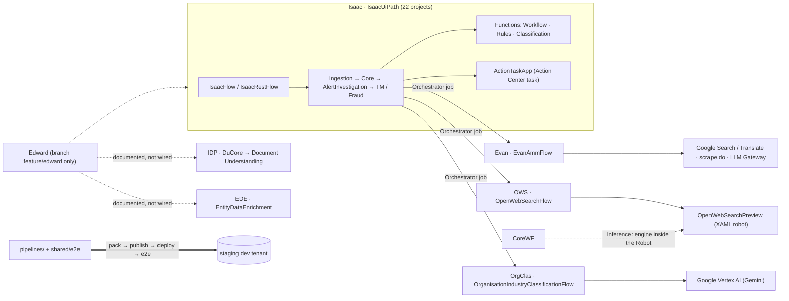

# UiPath-WorkFusion

- **Snapshot:** `main` @ `a223e56d`, 832 commits, 46 remote branches. The origin is
  `github.com/UiPath/UiPath-WorkFusion`, and CI runs in Azure DevOps.
- **Method:** read-only. Docs were checked against the code; nothing was run.
- **Paths** below are relative to the UiPath-WorkFusion repo.

## 1. What it is

A monorepo that ports WorkFusion **digital workers** to UiPath, like for like (`AGENTS.md:6-15`).
A digital worker is WorkFusion's packaged, persona-named automation product; these ones do
financial-crime compliance. Each port translates WorkFusion's Java code and business-process
graphs into UiPath artifacts, then proves with tests and live runs that the outputs match
WorkFusion's.

- **Why:** WorkFusion Isaac "had inadequate performance", so it is being rebuilt on UiPath "while
  preserving its business behavior". It is a translation, "not a redesign"
  . IDP is also meant as a reusable template, where "each customer trains
  its own" models.
- **Where it stands:** past porting, before production. Isaac has live parity runs and has been cut
  over from the WorkFusion providers to the UiPath ones, but only a staging dev environment exists.
- **What gets migrated:** a digital worker or one of its skills, such as Isaac's skill TMI or Evan's
  `DW-EVAN-AMM`. Parity must be "demonstrated with evidence and tests".
- **Unknown:** the business relationship between UiPath and WorkFusion, and the end customer. No
  file states either.

## 2. Map of the repo

| Path | What it holds |
|---|---|
| `AGENTS.md`, `CLAUDE.md` | Root AI guide: domain map, path conventions, test commands |
| | The AML investigation worker: `IsaacUiPath` solution, tests, evidence, WorkFusion snapshot, the old |
| | Adverse-media monitoring provider: `EvanUiPath` solution and tests |
| | Open-web-search provider: `OpenWebSearchUiPath` solution, tests, WorkFusion snapshot |
| | Industry-classification provider ("OrgClas"): solution, tests, WorkFusion snapshot, porting docs |
| | Edward's document processing: `IdpUiPath` solution (DuCore), the `wf-to-du` tools, specs |
| | Edward's entity data enrichment: `EDE` solution (FinCEN, SOS and MAP lookups) |
| | WorkFusion source-discovery CLI, the live e2e harness, platform rules |
| | Azure DevOps deploy pipelines and per-environment variables |
| | PR template |

## 3. How the pieces fit

- **Isaac is the hub.** It starts each provider as an Orchestrator job with `processes.invoke` and
  polls it with `jobs.retrieve` until done
  . The
  providers are separate Solutions that must be deployed and linked first
- **Edward is described, not built, on main.** The docs name IDP, EDE and OWS as its skills
  (`AGENTS.md:13`). Its orchestration exists only on branch `feature/edward`, and there it calls
  Isaac, Evan, OWS and "TR CLEAR", not IDP or EDE.
- **IDP is split across two tenants.** Its Document Understanding project is on staging tenant
  `workfusionmigrations`, not the tenant its pipeline deploys to

## 4. The port pattern

Every domain follows the same pattern, to different depths:

1. **Pin the WorkFusion source.** A script finds and clones
   WorkFusion repos from Bitbucket; 7 are indexed.
   A snapshot is checked in under the domain, and a test guards the pin.
2. **Capture reference outputs.** These are WorkFusion-generated inputs and outputs, e.g.
   `Isaac/test-data/{amy,christy,erik,verapont}/output/`.
3. **AI translates module by module.** Java-to-Python mapping tables record what went where. WorkFusion
   business-process graphs become Maestro Flows.
4. **Prove parity offline.** Port WorkFusion's own unit tests, keeping its expected values. Add
   contract tests against WorkFusion's schemas and graph tests against its business-process
   archives. `conftest.py` blocks network access.
5. **Record the evidence.** Dated evidence packs, a D-number for every difference from WorkFusion
   , and a log of every live run
6. **Deploy by pipeline and verify live.** Checkout → unit tests → pack → publish → deploy → link
   resources → e2e scenarios.
7. **Cut over.** Repoint callers from WorkFusion to the UiPath jobs. Isaac did this for all three
   providers in PR #81 (removal commit `1798b4f0` , merged ).

| Step | Isaac | Evan | OWS | OrgClas | IDP | EDE |
|---|---|---|---|---|---|---|
| WorkFusion source in the repo | ✓ pinned | ✗ index entry only | ✓ | ✓ pinned 1.0.19 | ✗ specs only | ✗ spike repo |
| Reference outputs | ✓ 4 sets | Fixtures only | ✓ 1 capture | ✓ 24 counterparties | WorkFusion labels (not committed) | ✗ |
| Offline parity tests | Graph, contract, behaviour | ~1,181 ported Java tests | WorkFusion test config reused | Ported Java tests; 24 exact matches | ✗ | ✗ (field names only) |
| Live parity | ✓ runs 75–78 | ✗ | Unproven | ✓ 23 of 24 | ✗ | ✗ |
| Pipeline e2e (dev) | Smoke nightly, parity on request | Stub smoke | Smoke; parity on request | Smoke | None | 3 smoke + 1 regression |

## 5. Status at a glance

| Domain | Ports (WorkFusion side) | UiPath solution | Status |
|---|---|---|---|
| Isaac | `dw-isaac-tmi` worker, 10 business processes, `ds-transaction-analysis` model | `IsaacUiPath.uipx`, 22 projects | **Done** on staging; logged differences remain open |
| Evan | `DW-EVAN-AMM` 4.7.0 and AMM model 3.7.3 | `EvanUiPath.uipx`, 4 projects | **Partial** |
| OWS | `open-web-search` worker | `OpenWebSearchUiPath.uipx`, 3 projects | **Works**; parity not demonstrated; slow |
| OrgClas | `counterparty-information-provider` 1.0.19 | `OrganisationClassificationUiPath.uipx`, 2 projects | **Done** on staging (23 of 24 live) |
| IDP | Document Harvester (`dw-idp-dh`) | `dw-idp-dh.uipx`, 2 projects | **Core done**; no e2e |
| EDE | `dw-ede` spike repo | `EDE.uipx`, 5 projects | **Partial**: FinCEN done, SOS in PRs, MAP a stub |
| Edward | Enhanced Due Diligence orchestration | Branch `feature/edward` only | **Not on main** |

### Isaac

- **What it does:** investigates AML transaction-monitoring alerts. For each customer it gathers
  transactions, screens counterparties, applies rules and an ML model, then writes a status (e.g.
  `LOW_RISK`), a comment and Excel/Word reports.
- **WorkFusion side:** digital worker Isaac, skill TMI (Transaction Monitoring Investigator). Its
  parts are:
  - the `dw-isaac-tmi` Java worker;
  - 10 business-process archives;
  - schemas and a React manual-task UI;
  - the `ds-transaction-analysis` Python model, run through WorkFusion's Python Bridge.

  The snapshot of `dw-isaac-tmi` is master @ `338d551eb` (`2.4.0-dev`). The Flow graph is pinned separately at `5e074be8`.
- **UiPath side:** 22 projects.
  - 15 Maestro Flows. The entry points are `IsaacFlow`, which sweeps the input bucket or takes a
    named `.xlsx`/`.csv`, and `IsaacRestFlow`, which takes one entity JSON like WorkFusion's REST
    path. The chain runs FileIngestion → Core →
    AlertInvestigation → TransactionMonitoring or FraudInvestigation, plus one Flow per provider.
  - 3 Python coded Functions:
    - `IsaacWorkflowFunctions`: every processor.
    - `IsaacRulesFunction`: 24 prebuilt rules, 24 MVB/no-code rules and the fraud rules; a local
      engine, or optionally UiPath's DMN business-rules API.
    - `IsaacClassificationFunction`: the Transaction Analysis model port.
  - 3 coded apps: `IsaacConfigurationApp`, `IsaacWorkspace`, and `ActionTaskApp` (the Action
    Center task for deferral approval).
  - An RPA process `Demo`, and 6 storage buckets. Data Fabric has been unused.
- **Status:** done on staging.
  - 76 of 80 Flow nodes are implemented. The other 4 (ACH, cheque, email, Action Center) are
    "external binding pending".
  - Live runs 75–78 (package 5.0.5, folder `StableIsaac`) had 0 incidents and
    cell-identical outputs apart from logged differences.
  - Open differences: D9, D20–D23, D27–D30 and D32–D37.
  - Stubs: ACH lookup, cheque lookup and the reviewer email.
  - Performance: the 1M-transaction target was met on 3.0.0 but hasn't been re-measured on 5.x
- **Parity proof:**
  - 164 pytest files: graph vs WorkFusion's business-process archives, contract vs the WorkFusion
    schema, behaviour, classification. The last recorded result is 1,627 passed, 1 skipped
  - Diff harness in `Isaac/test-data/_diff/`; evidence packs in `Isaac/evidence/`.
  - Live scenarios and
    `christy-workfusion-parity.yaml`.
- **Deploy:** nightly at 02:00 UTC into `CICD/IsaacDevE2E`. The
  parity runs were deployed by hand to `PatrickIsaac` and `StableIsaac`.
- **Watch-outs:**
  - Committed WorkFusion dev credentials.
  - D32: a long Maestro run stops without raising an incident
  - Stale counts.
  - Build output committed inside the solution (`IsaacConfigurationApp/dist*/`).
- **Also here:** `Isaac/POC/AMLRulesIntegrationShadowCandidate/` is an earlier UiPath attempt. It
  holds all 9 API-workflow and 5 Agent projects in the repo, and is kept for comparison only

### Evan

- **What it does:** adverse-media monitoring (AMM). For each person or company Isaac screens, it:
  - runs Google searches of the name plus crime keywords;
  - downloads and extracts the articles, then filters and de-duplicates them;
  - classifies each article: is it negative, and is it about this subject?
  - returns a status (e.g. `TRUE_POSITIVE`, `NEEDS_INVESTIGATION`, `NON_ADVERSE`), an HTML report
    and an `AmmResponse`.
- **WorkFusion side:**
  - the Java/Spring worker `adverse-media-monitoring`, translated from 4.5.1 and re-targeted to
    4.7.0;
  - the `amm-classification` model 3.7.3 (ONNX/scikit-learn, ~3.6 GB);
  - article extractors, FreeMarker report templates (now Jinja) and a Form.io configuration page.

  No WorkFusion source is in the repo, only an index entry.
- **UiPath side:** `EvanUiPath`.
  - `EvanAmmFlow` runs load-input, then acquire (per subject, in parallel), then one score job,
    then finish.
  - `EvanAmmFunction` dispatches on an `operation` input (`entrypoints.py`).
  - `EvanScoreFunction` runs the score stage on a Large robot.
  - `EvanConfigurationApp` renders 395 fields of WorkFusion's form and writes `config/tenant.json`.
  - Resources: 2 buckets (`EvanInputBucket`, `EvanOutputBucket`) and 5 Secret assets (Google
    Search key and cx, Translate, scrape.do, browser-use).
  - Classifier engines: `llm` is the code default and uses the UiPath LLM Gateway with
    `gpt-4.1-mini`. `model-subprocess`, the WorkFusion model run in a child Python 3.11 from
    bucket blobs, is the one that runs in the deployed Function.
- **Status:** partial.
  - The pipeline is at 4.7.0.
  - The real model ran in the Function (178 s), and 3.7.3 was uploaded. The cloud
    comparison with WorkFusion is still outstanding.
  - Not ported: NLP de-duplication, manual review, batch and purge
  - The config app was merged (PR #76).
- **Parity proof:** `Evan/tests/wf_parity/` ports ~1,181 WorkFusion Java tests with WorkFusion's
  expected values, and `SKIPPED.md` records what wasn't ported. Classifier quality is not proven.
  The only e2e scenario is a stub that "proves nothing about Google, the classifier or the report".
- **Deploy:** nightly at 03:30 UTC into `CICD/EvanDevE2E`. It sets
  the score Function to a Large robot.
- **Watch-outs:**
  - Config-file mismatch: the app writes `config/tenant.json`, the Function defaults to
    `config.json`, and Isaac passes an empty file name.
    Runs started by Isaac therefore ignore what the app saved.
  - Articles are scored by the LLM unless the model settings are bootstrapped.
  - Duplicate grouping is requested (`useNlpModel`) but not implemented.
  - Model 3.7.3 needs ~5.2 GB of RAM and a 3.5 GB download per cold container.
  - A 1,238-file restructure branch is in flight: `feature/EXPERT-39741-evan-project-structure`.

### OWS

- **What it does:** takes a company as an `OWSInput` and:
  - checks whether it is publicly listed, using the OpenFIGI API;
  - searches the web (Google on by default, Brave off);
  - optionally screenshots the top results;
  - writes a PDF/HTML report to a bucket and returns an `OWSResult`.

  It uses no LLM.
- **WorkFusion side:** the `open-web-search` Java worker. The snapshot is in
  `OWS/workfusion-code-ref/workfusion-open-web-search/`; the index says upstream `develop` @
  `1623073f`.
- **UiPath side:** `OpenWebSearchUiPath` has three projects:
  - `OpenWebSearchFlow`, the entry point;
  - `OpenWebSearchFunction`, in Python;
  - `OpenWebSearchPreview`, a XAML RPA robot that screenshots results in one Chrome session.

  Resources: bucket `OpenWebSearchReports` and 4 Secret assets.
- **Status:** works, but parity is not demonstrated.
  - Google was called live.
  - Screenshots work on a Linux robot; headless mode fails.
  - The report content is equivalent, the visual output is not.
  - The HTTP façade was removed, and Isaac was repointed.
- **Parity proof:**
  - 322 unit-test functions (the README claims 356 passed), reusing WorkFusion's
    integration-test configuration.
  - A parity scenario, exists but isn't
    run nightly; whether it has passed is unknown.
  - The README calls it "not a demonstrated parity claim"
  - An unmerged branch, `feature/SW-32581-two-screen-capture-flows`, reports 26 of 26 matching.
- **Deploy:** nightly at 02:30 UTC into `CICD/OwsDevE2E`. Isaac uses a
  different shared folder (`OpenWebSearchUiPathShared`) and pins version 1.0.56.
- **Watch-outs:**
  - 5m 8s per run against WorkFusion's ~20s.
  - has `requiresUserInteraction: false`, where the README
    says it "must stay true".
  - A committed `debug_overwrites.json` holds tenant and resource IDs.

### OrgClas

- **What it does:** takes a party (the bank's customer) and a counterparty (the other side of a
  transaction). It returns each side's industry as NAICS codes, and a cross-industry risk (`high`,
  `low` or `not_assessed`) from a 38×38 matrix. The steps are:
  - a BERT NER model decides company or person;
  - TF-IDF keyword matching classifies the party;
  - Gemini on Google Vertex AI resolves the counterparty, behind a cache;
  - the risk lookup runs.
- **WorkFusion side:**
  - the `counterparty-information-provider` worker 1.0.19, pinned at `07e849a6` in
    `OrganisationClassification/workfusion-code-ref/`;
  - its NER model;
  - a SQL Server cache and Vault secrets.

  The reference data was produced by 1.0.16; the difference is kept as a patch in
  `OrganisationClassification/workfusion-code-ref/version-diffs/`.
- **UiPath side:** `OrganisationClassificationUiPath.uipx`:
  - a Flow;
  - a Function with operations `classify` and `classify-batch`;
  - a bucket for the NER files;
  - Data Fabric entity `OrgClasEntitySearchResult` as the cache;
  - Vertex secret and location assets.
- **Status:** done on staging.
  - Offline, the 24 reference counterparties match exactly.
  - Live, 23 of 24 match on every field. The miss is one WorkFusion's own Gemini never resolved
  - Isaac has called it only as a job.
- **Parity proof:**
  - Tests in `tests/unit` (24 ported Java test classes), `tests/parity` and `tests/contract`.
  - Scripts in `OrganisationClassification/OrganisationClassificationUiPath/scripts/`: `live_parity.sh`,
    and `seed_reference_cache.sh`, which takes Gemini's
    run-to-run variation out of the grade.
- **Deploy:** nightly at 03:00 UTC into `CICD/OrgClasDevE2E`. It
  links resources to `OrganisationClassificationUiPathShared` and sets a Medium (4 GB) robot.
- **Watch-outs:**
  - About 50 s of cold start per job, so one counterparty per job costs 51–65 s
  - A deploy can reset the Vertex secret to `<unset>` (`:550-568`).
  - 1 GB robots die with no error.
  - Pack with the solution pack script,
    not a plain `uip solution pack`.
  - Isaac pins 1.0.9, but its live runs used the shared 1.1.0.
- **Why it matters:** it calls itself a "100 %-AI port"
  and ships its porting harness. It is the cleanest
  template for starting a new port.

### IDP

- **What it does:** classifies documents and extracts fields. It is one of Edward's skills.
- **WorkFusion side:** IDP / Document Harvester (`dw-idp-dh`) with its AutoML extraction models. No
  WorkFusion source is in the repo, and the dataset exports (real customer documents) are never
  committed.
- **UiPath side:** `dw-idp-dh`:
  - `DuCore`, a Python Function that calls Document Understanding Classic to digitize, classify
    and extract;
  - a minimal Flow, still named "New Flow";
  - 11 `DU_*` assets;
  - input from a bucket (default `EdwardDocuments`) or from Data Fabric.

  Separately, a converter turns WorkFusion's labelled data into a Document
  Manager import. Models are retrained on UiPath, not moved.
- **Status:** the core is done and deployed to staging, and bucket input is done. There are no e2e
  tests and no parity suite against Document Harvester.
- **Deploy:** nightly at 04:30 UTC into `CICD/IdpDevE2E`, with
  `runE2e: false`. It gates on 5 of ~461 tests.
- **Watch-out:** Studio debug runs execute in your personal workspace folder, not the debug folder

### EDE

- **What it does:** checks an entity against public registries:
  - FinCEN MSB, the US register of Money Services Businesses;
  - SOS, the state Secretary of State business registries;
  - MAP, a map or Street View check of the address.

  It is one of Edward's skills.
- **WorkFusion side:** came from the `dw-ede` spike. There is no reference snapshot; only the
  field names mirror WorkFusion's.
- **UiPath side:** `EDE`:
  - Flow `EntityDataEnrichment`: input → parallel loop → switch by source → post-processing;
  - Functions `EdeInput`, `EdeFincenSearch`, `EdeSosSearch` and `EdeMapSearch`;
  - bucket `EdeEvidenceBucket`.
- **Status:** partial.
  - EdeInput and FinCEN are done (PR #75).
  - SOS and MAP are stubs on main.
  - SOS is being built on four overlapping branches. PR #85 (12 states) is in review, and
    `feat/ede-sos-ui` adds a XAML browser robot for registries behind Cloudflare.
  - MAP has no implementation on any branch.
- **Deploy:** nightly at 04:00 UTC into `CICD/EdeDevE2E`.
- **Watch-outs:**
  - FinCEN's terms for automated access are unconfirmed.
  - Python coded Functions were a preview feature.
  - The `.flow` and `.bpmn` copies of the flow are kept in sync by hand.

### Edward (branch `feature/edward` only)

- A new domain: an `EdwardOrchestration` flow plus two Functions,
  `GenerateIsaacInputXlsx` and `WriteIsaacInputToBucket`. It calls Isaac, Evan, OWS and TR CLEAR.
- It is not on main. The unmerged branch `docs/uninstalled-deployment-keeps-its-name` records a
  hand deployment to `CICD/EdwardDevE2E`.

### Platform: and

- **:** a CLI that finds and clones WorkFusion repos from
  Bitbucket workspace `work-fusion`. Subcommands: `index`, `auth`, `discover`, `check`, `sync`,
  `status` and `search`.
  - Its index, lists 7 repos. `nss-classification-model`
    (Evelyn's model) is marked ruled out.
  - The cache directory `shared/workfusion-source-code/` is git-ignored.
- **`shared/e2e/`:** the live harness.
  - YAML scenarios live in `shared/e2e/scenarios/<Domain>/`, and the registry is
  - Tiers: smoke, regression, parity and performance.
  - It checks the job state and the output content (JSON, xlsx and docx against a reference).
  - Scenario counts: Isaac 2, OWS 2, OrgClas 1, Evan 1, EDE 4, IDP 0. There is no performance
    scenario.
- **:** the platform rules (tenant, folders, identities) and the completion rules
  for agents, e.g. "cite a green run id".
- **:** one `<domain>-deploy.yml` per solution, plus `e2e.yml`, step templates, and

## 7. Environments and deployment

- **Tenant:** org `uipathstgSS_updated`, tenant `UiPathDefault`, authority
  `https://staging.uipath.com`, shared by every domain.
- **Folders:**
  - `CICD/<Solution>DevE2E` per solution.
  - Shared resources in `StudioWeb` and `OrganisationClassificationUiPathShared`.
  - Hand-deployed parity folders `PatrickIsaac` and `StableIsaac`.
- **Identities:** pipelines sign in as external application `WorkfusionAzurePipelines` (client
  credentials, kept in ADO variable group `uipath-cli-dev`). Jobs run as robot account
  `cicdunattended`.
- **Triggers:**
  - `trigger: none`, so pushes build nothing.
  - PRs into main run checkout and unit tests only.
  - Nightly runs on main are staggered: Isaac 02:00, OWS 02:30, OrgClas 03:00, Evan 03:30,
    EDE 04:00, IDP 04:30 UTC (`cron:` lines ).
  - Nightlies run the smoke tier; the parity tier runs only on request.
- **CLI:** Isaac installs the latest `uip`; the other five pin
  1.200.1. CLI 1.201.x once broke 10 of 15 Isaac flows.
- **Test and prod don't exist yet.** Every `*-test.yml` and `*-prod.yml` has a blank org, tenant and
  authority. Only dev ADO environments and
  variable groups exist.

## 8. History and momentum

**Phases**
1. A one-person AML demo (Ben Walker; first commit `17d1d5ed`).
2. Team spin-up in a predecessor repo, `fcc-aml-fraud-isaac-augmentation`.
   WorkFusion source added (`82430489`); "Isaac generated from source code" (`8f9da995`).
3. Restructure into domain folders (`ef1fd42a`, 8,154 renames), then a new repo.
4. CI/CD and e2e (`02dcbeff`), the OrgClas port (`e41d601d`), the IDP import
   keeping `dw-idp-dh` history (`4883b1d3`), and the EDE import (`59de5c69`).
5. Parity catch-up, the provider cut-over (PR #81), and delivery runs 64–78,
   whose outputs were "handed to WorkFusion" (`b64aa8e9`).

**Pace:** commits per month across four months were 7, 3, 163 and 659. The last three
weeks had 181, 228 and 199.

**Commits per domain folder:** Isaac 258, Evan 129, pipelines 90, IDP 53, shared 45, OrgClas 30,
OWS 17, EDE 12.

**In flight:** 22 unmerged branches, all touched in the three weeks before the snapshot. Several
are only leftovers of squash-merges.
- **EDE SOS:** `feat/ede-sos-al-ar-co` (PR #74, has conflicts),
  `feature/ede/sw-32589-sos_python_implementation` (PR #85), `feat/ede-sos-ui` and
  `feature/SW-32654`.
- **Evan:** `feature/EXPERT-39741-evan-project-structure`.
- **OWS:** `feature/SW-32581-two-screen-capture-flows`.
- **Edward:** `feature/edward`.
- **Isaac:** fixes such as `fix/isaac-deploy-default-app-collision`.

**Not started:** test and prod environments, EDE MAP, IDP e2e tests, any performance-tier e2e
scenario, and a scheduled parity run.

**Contributors on main, most commits first:**
- Patrick Vitoga (Isaac, OrgClas), flaviusm / flavius-manea (restructure, CI) and Daniel Dinca
  (e2e, pipelines, EDE).
- Almir Aquino (Evan), Alin Velea (Evan, Isaac), Mira Stroie (Isaac) and Ilya Shmaust (IDP).
- Diana Cordun (IDP's origin) and Ben Walker (the demo).
- Smaller: Lasit Pant, Sorin Constantin, Andrei Vintila and Nina Kudina.
- Seen only on branches: Eduard Polazau, Max Shmidov, Igor Zhukov and Barry Foye.

**Ticket prefixes:** EXPERT- (the same Jira project Evelyn uses) and SW-.

## 9. How AI is used

- **Writing the code:**
  - 577 of 832 commits (69%) carry `Co-Authored-By: Claude`, about 90% of the latest month's non-merge
    commits. The trailers name Fable 5.1, Opus 5, Opus 5.5, Sonnet 5 and others.
  - Codex appears on 8–9 commits.
  - GitHub Copilot reviews and auto-fixes EDE PRs.
- **Guides:** each domain's `AGENTS.md` is an "AI Workspace Guide", and each `CLAUDE.md` just
  imports it with `@AGENTS.md`. The exception is OWS, whose `CLAUDE.md` is a separate copy that
  has drifted.
- **Process:**
  - Spec → plan → test-driven development with the "superpowers" skills: 38 plans and specs in
    `Isaac/docs/superpowers/`, plus `IDP/specs/`.
  - Hand-off notes such as "For the next AI session"
  - Starter prompts.
- **Humans:** Inference: people direct and review the work and run the tenant deploys. "100 %-AI"
  means AI-written under human direction.

## 10. Risks, ranked (observations for the owning teams)

1. **Credentials in Git.** has non-empty defaults
   for a WorkFusion dev username, password, client ID and client secret. That contradicts the
   file's own comment ("Keep secrets blank in committed code"). They stay in history, so rotation
   is the owners' call.
2. **No path to production.**
   - Test and prod are blank.
   - Everything shares one staging tenant.
   - Isaac's dev deploy auto-uninstalls deployments when a resource link is refused
3. **Uneven parity proof.**
   - Evan: classifier quality is unproven.
   - OWS: not demonstrated.
   - IDP: no comparison with Document Harvester.
   - EDE: only the field names match.
   - Isaac: D32 is open.
4. **Performance short of the stated goal.**
   - OWS takes 5m 8s against ~20s.
   - OrgClas takes 51–65 s per counterparty.
   - Isaac run 62 took 35 minutes, mostly Evan retrying Google 429 errors
   - Isaac's 1M-transaction result hasn't been re-measured on 5.x.
5. **Silent wiring mismatches.**
   - The Evan config file name.
   - Evan's LLM default.
   - OWS `requiresUserInteraction`.
   - OrgClas pinned at 1.0.9 while the shared deployment runs 1.1.0.
   - Secret assets reset to `<unset>` by a deploy.
6. **Stale AI guides.** Inference: with ~90% AI-written commits, `AGENTS.md` works like code, and
   stale guidance steers agents wrong. See §11.
7. **Fragile toolchain.** The `uip` CLI is unpinned in Isaac's pipeline.
8. **External and legal dependencies.**
   - FinCEN's terms for automated access.
   - SOS registries behind Cloudflare.
   - Vertex AI needs a Google service account.
   - Python coded Functions were a preview feature.
9. **Missing provenance.**
   - Evan, IDP and EDE have no WorkFusion snapshot in the repo.
10. **Repo hygiene.**
    - Committed build output (`IsaacConfigurationApp/dist*/`, including a "…1.2.0 copy/" folder).
    - 14 `.nupkg` files.
    - A committed `debug_overwrites.json`.

## 11. Docs that contradict the code

| Doc says | Code or history says |
|---|---|
| The OrgClas solution and tests are "to be created" (`AGENTS.md:11,84`) | 79 solution files and 31 test files exist; the domain guide agrees |
| Isaac calls Evan through an `amm-provider: workfusion \| local` switch | That switch was removed; Isaac starts `EvanAmmFlow` as a job |
| Evan 4.7.0 work is on its branch and model 3.7.3 is "pending" | The branch is merged; 3.7.3 is verified and uploaded |
| `EvanAmmFlow` has "two inputs, both scalars" | `entry-points.json` has four |
| OrgClas has "not yet run on the platform" | Live , 23 of 24 matching |
| OWS was never deployed and made no Google call | A tenant run returned Google results, and Isaac pins OWS 1.0.56 |
| "Isaac does not call this solution [Evan] yet" | Isaac's dev deploy links `EvanAmmFlow` (PR #81) |
| The IDP solution has no assets and no bucket input | 11 assets (`d0887fa1`) and a bucket source exist |
| Isaac has "24 projects" and "71 nodes, 67 implemented" | 22 projects; 80 nodes, 76 implemented |
| Isaac's baseline is `ca0d3f12` | The snapshot and pin test say `338d551eb` |
| The PR template lists 5 domains | The repo has 8 top-level areas |

## 12. Open questions (the repos don't answer these)

- Who is the business owner or customer, and what is the relationship between UiPath and
  WorkFusion?
- When will test and prod exist, and on which tenant?
- Which SOS branch wins, and is MAP in scope?
- Will Edward land on main, and will it call IDP and EDE as the docs say?
- Where will IDP's DuCore run, given that its DU project is on another tenant?
- Is an LLM acceptable in place of WorkFusion's model for Evan?
- Which worker is ported next? Evelyn was designed in and removed once.
